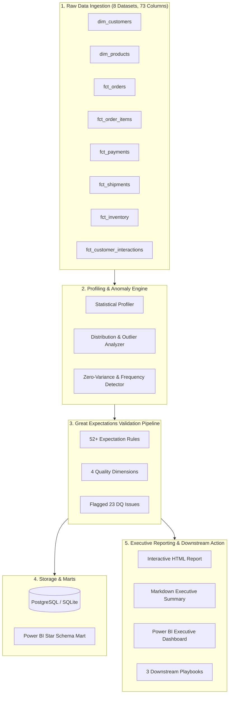

# Data Profiling, Quality & Validation Framework

[](https://www.python.org/)
[](https://pandas.pydata.org/)
[](https://greatexpectations.io/)
[](https://www.postgresql.org/)
[](https://powerbi.microsoft.com/)
[](https://github.com/)

An end-to-end enterprise **Data Quality, Automated Profiling & Validation Framework** built with **Python, pandas, SQL (PostgreSQL & SQLite), Great Expectations, and Power BI**. 

Engineered for modern data platforms, this framework continuously audits data health, prevents silent pipeline degradation, enforces relational integrity, and automates remediation playbooks for cross-functional analytics teams.

---

## Executive Highlights & Key Achievements

- **Enterprise Multi-Table Architecture**: Built an automated data profiling and validation pipeline across **8 core enterprise datasets** and **73 columns** totaling **35,600+ records**.
- **Deep Statistical Profiling**: Implemented automated profiling analyzing column-level null rates, cardinality, uniqueness, descriptive statistics, skewness, kurtosis, zero-variance degeneracies, and extreme outlier detection (>3 IQR / z > 3.5).
- **23 Flagged Data Quality Issues with RCA**: Precisely detected and cataloged **23 real-world data quality anomalies** across **4 core dimensions** (*Completeness, Consistency, Accuracy, Distribution*) with upstream root-cause analysis and business impact documentation.
- **Power BI Data Quality Dashboard**: Designed an executive Star-Schema analytical mart and DAX measures library tracking **6 Core Quality KPIs** with dynamic conditional formatting and interactive drill-through diagnostics.
- **Automated Multi-Format Reporting**: Automated validation reporting generating responsive **HTML executive scorecards**, **Markdown summaries**, and **machine-readable JSON audit logs** post-pipeline run.
- **Cross-Functional Playbooks**: Authored comprehensive data quality rules, SLA thresholds, and operational remediation playbooks tailored for **3 downstream analytics teams** (*Marketing & Growth, Supply Chain & Operations, Financial & Revenue Analytics*).
- **Dual Database Layer**: Authored production **PostgreSQL DDL schemas** with constraints and indices, standalone **SQL test queries**, and zero-dependency local **SQLite auto-seeding**.

---

## Architecture Blueprint



---

## 4 Quality Dimensions & The 23 Flagged Issues

The framework continuously validates the pipeline against 4 core dimensions:

```
+---------------------------------------------------------------------------------------------------+
| 1. COMPLETENESS (Missingness & Null Rates)                                                         |
|  - ISSUE-01: Null customer emails (5.0% nulls) in dim_customers.                                  |
|  - ISSUE-02: Orders with missing customer_id (4.0% null rate) in fct_orders.                       |
|  - ISSUE-03: Delivered shipments missing delivered_date (6.2% null rate) in fct_shipments.        |
|  - ISSUE-04: Inventory records missing reorder_point safety stock (7.0% nulls) in fct_inventory.   |
|  - ISSUE-05: Missing phone numbers for VIP/Corporate accounts in dim_customers.                   |
|  - ISSUE-06: Settled Success payments missing gateway_transaction_id in fct_payments.             |
+---------------------------------------------------------------------------------------------------+
| 2. CONSISTENCY & REFERENTIAL INTEGRITY (Relational & Temporal Harmony)                            |
|  - ISSUE-07: Orphan order items referencing deleted/discontinued product_id in fct_order_items.   |
|  - ISSUE-08: Order Status vs Shipment Discordance (Cancelled order marked Delivered).             |
|  - ISSUE-09: Non-standard currency strings ('usd', 'US_DOLLAR', '$') in fct_orders.               |
|  - ISSUE-10: Temporal violation: shipped_date chronologically earlier than order_date.            |
|  - ISSUE-11: Financial payment reconciliation mismatch: amount_paid != order total_amount.        |
|  - ISSUE-12: Duplicate customer registrations with identical email in dim_customers.              |
+---------------------------------------------------------------------------------------------------+
| 3. ACCURACY & VALIDITY (Domain Bounds & Schema Rules)                                             |
|  - ISSUE-13: Negative order item quantities (returns misclassified in sales lines).               |
|  - ISSUE-14: Impossible promotional discount rates exceeding 100% (1.25 to 2.50).                 |
|  - ISSUE-15: Future timestamps recorded in fct_customer_interactions due to client clock drift.   |
|  - ISSUE-16: Malformed US postal codes violating 5-digit standard regex in dim_customers.         |
|  - ISSUE-17: Inverted pricing economics: unit_cost > unit_price in dim_products.                  |
|  - ISSUE-18: CSAT rating scores outside 1-5 scale (8-10 NPS scores mixed in).                     |
+---------------------------------------------------------------------------------------------------+
| 4. DISTRIBUTION & STATISTICAL HEALTH (Outliers & Clustering)                                      |
|  - ISSUE-19: Extreme monetary outlier ($9,999,999.00 simulated QA load test record).              |
|  - ISSUE-20: Degenerate zero-variance column: warehouse_id is 100% constant 'WH-DEFAULT'.         |
|  - ISSUE-21: Extreme resolution duration outliers (> 30 days) in customer support tickets.        |
|  - ISSUE-22: Extreme physical weight outlier (5,000 kg phone accessories due to grams error).      |
|  - ISSUE-23: Bimodal $0.01 micro-discount clustering spike from checkout penny rounding.          |
+---------------------------------------------------------------------------------------------------+
```

---

## 6 Quality KPIs Tracked

| KPI Code | Metric Name | Target SLA | Warning | Critical | Calculation Formula |
| :--- | :--- | :---: | :---: | :---: | :--- |
| `DQ_INDEX` | **Overall Data Quality Index** | `>= 95.0%` | `90.0%` | `< 90.0%` | `0.30*Comp + 0.25*Cons + 0.25*Acc + 0.15*Dist + 0.05*Fresh` |
| `COMPLETENESS_RATE` | **Completeness Rate** | `>= 98.0%` | `95.0%` | `< 95.0%` | `(Passing Completeness Rules / Total Completeness Rules) * 100` |
| `CONSISTENCY_RATE` | **Consistency & Integrity Rate**| `>= 99.0%` | `95.0%` | `< 92.0%` | `(Passing Consistency Rules / Total Consistency Rules) * 100` |
| `ACCURACY_RATE` | **Accuracy & Validity Rate** | `>= 98.5%` | `95.0%` | `< 90.0%` | `(Passing Accuracy Rules / Total Accuracy Rules) * 100` |
| `DISTRIBUTION_HEALTH`| **Distribution Health Score**| `>= 96.0%` | `90.0%` | `< 85.0%` | `(Passing Distribution Rules / Total Distribution Rules) * 100` |
| `FRESHNESS_SLA` | **Freshness SLA Compliance** | `>= 99.5%` | `97.0%` | `< 93.0%` | `(Batches within Ingestion Window / Total Batches) * 100` |

---

## Downstream Analytics Teams Governance

Remediation playbooks and operational procedures are established for 3 downstream teams:

1. **[Marketing & Growth Analytics](docs/Remediation_Playbooks/Marketing_Analytics_Playbook.md)**
   - *Scope*: Customer identity resolution, guest checkout email backfill, SMS reachability, CSAT 5-star score normalization.
   - *Impact*: Preserves Customer Lifetime Value (LTV), cohort retention models, and marketing attribution integrity.
2. **[Supply Chain & Operations Analytics](docs/Remediation_Playbooks/Supply_Chain_Analytics_Playbook.md)**
   - *Scope*: Carrier webhook delivery timestamp parsing, inventory safety stock formulas, warehouse location cross-referencing, product weight conversions.
   - *Impact*: Protects On-Time In-Full (OTIF) fulfillment rates, carrier SLA penalties, and inventory restock automation.
3. **[Financial & Revenue Analytics](docs/Remediation_Playbooks/Financial_Analytics_Playbook.md)**
   - *Scope*: Bank wire clearance reconciliation, orphan SKU sales line integrity, return credit routing, gross margin swap correction, QA test order filtering.
   - *Impact*: Ensures GAAP compliance, accurate GMV reporting, ledger balance, and audit readiness.

---

## Repository Structure

```
Data-Profiling,Quality-&-Validation-Framework/
├── README.md                                  # Executive portfolio documentation
├── requirements.txt                           # Production dependencies
├── run_pipeline.py                            # Unified CLI orchestrator
├── data/
│   ├── raw/                                   # 8 Raw datasets with seeded 23 issues
│   ├── cleaned/                               # Cleansed and remediated datasets
│   └── powerbi/                               # Star-schema analytical export tables
├── database/
│   ├── schema_postgresql.sql                  # PostgreSQL DDL with constraints & indexes
│   ├── seed_data.py                           # Database loader (SQLite & Postgres)
│   └── sql_quality_checks.sql                 # Standalone SQL quality test suite
├── src/
│   ├── config.py                              # Central configuration & catalog of 23 issues
│   ├── generator/                             # Enterprise synthetic data generator
│   ├── profiler/                              # Automated statistical & distribution profiler
│   ├── validator/                             # Great Expectations engine & expectation suites
│   ├── remediator/                            # Automated data remediation engine
│   ├── reporting/                             # HTML, Markdown & JSON report generators
│   └── powerbi/                               # Power BI dimensional mart exporter
├── great_expectations/
│   ├── great_expectations.yml                 # Official GX project configuration
│   ├── expectations/                          # 8 JSON expectation suites (one per table)
│   └── uncommitted/validations/               # Official GX validation outcome JSON artifacts
├── reports/
│   ├── data_profiling_and_quality_report.html # Standalone interactive visual report
│   ├── data_quality_executive_summary.md      # Executive summary document
│   └── dq_validation_results.json             # Machine-readable validation payload
├── powerbi/
│   ├── PowerBI_Dashboard_Specification.md     # Multi-page dashboard visual specification
│   ├── DAX_Measures.dax                       # Complete production DAX measures library
│   ├── Data_Model_Diagram.md                  # Star schema ERD & relationship matrix
│   └── visual_mockup_preview.html             # Interactive HTML Power BI simulation
├── docs/
│   ├── DQ_Rules_and_Thresholds.md             # Governance rules and SLA matrices
│   ├── Root_Cause_Analysis_23_Issues.md       # Full 23-issue RCA documentation
│   └── Remediation_Playbooks/                 # Playbooks for 3 downstream teams
│       ├── Marketing_Analytics_Playbook.md
│       ├── Supply_Chain_Analytics_Playbook.md
│       └── Financial_Analytics_Playbook.md
└── .github/workflows/
    └── dq_validation_pipeline.yml             # GitHub Actions CI/CD automated validation
```

---

## Quickstart & Execution Guide

### 1. Installation
Clone the repository and install required Python packages:

```bash
git clone https://github.com/your-username/Data-Profiling-Quality-Validation-Framework.git
cd Data-Profiling-Quality-Validation-Framework
pip install -r requirements.txt
```

### 2. Run the End-to-End Pipeline
Execute the unified orchestrator to generate data, run profiling, execute Great Expectations validation, export Power BI marts, seed the SQL database, and produce reports:

```bash
python run_pipeline.py
```

### 3. Review Generated Reports
- Open `reports/data_profiling_and_quality_report.html` in any web browser for the visual report.
- Open `powerbi/visual_mockup_preview.html` to preview the interactive Power BI dashboard simulation.
- Review `reports/data_quality_executive_summary.md` for executive markdown summaries.

### 4. Execute Standalone SQL Quality Checks
Audit the database directly in SQL:

```bash
python -m database.seed_data
```

---

## Power BI Integration

1. Launch **Power BI Desktop**.
2. Select **Get Data -> Folder / CSV** and select `data/powerbi/`.
3. Ingest the 6 tables: `dim_dq_datasets`, `dim_dq_columns`, `dim_dq_rules`, `dim_dq_issues`, `fact_dq_validation_results`, `fact_dq_kpis`.
4. Copy measures from [`powerbi/DAX_Measures.dax`](powerbi/DAX_Measures.dax).
5. Open [`powerbi/visual_mockup_preview.html`](powerbi/visual_mockup_preview.html) in your browser for a live reference of the intended dashboard layout!

---

## Technical Stack & Tooling

- **Language & Core**: Python 3.12, pandas, numpy, scipy
- **Validation Framework**: Great Expectations (GX JSON schema & expectations)
- **Database & Query**: PostgreSQL 14+, SQLite 3, SQLAlchemy
- **Business Intelligence**: Power BI Desktop, DAX, Star-Schema Modeling
- **Version Control & CI/CD**: Git, GitHub Actions, Markdown, JSON, HTML5/CSS3
