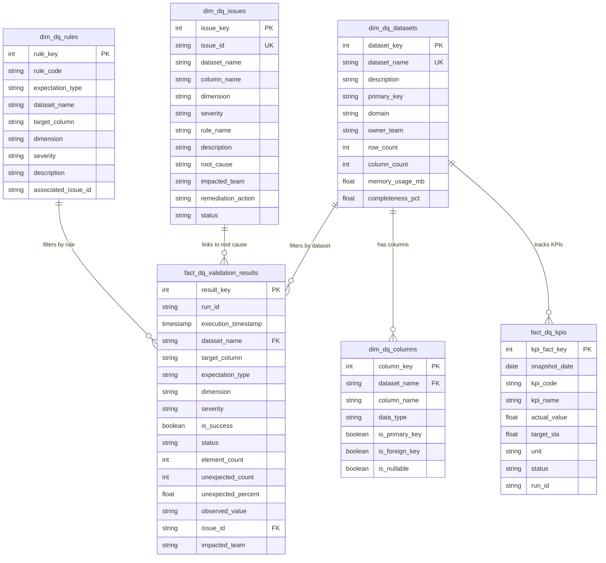

# Power BI Star Schema Data Model Architecture

This document describes the dimensional data model designed for the enterprise **Data Quality, Profiling & Validation Framework**.

---

## 1. Star Schema Entity-Relationship Diagram

---

## 2. Table Relationships and Cardinality

| From Table (Dimension) | To Table (Fact) | Primary Join Key | Cardinality | Cross-filter Direction |
| :--- | :--- | :--- | :---: | :---: |
| `dim_dq_datasets` | `fact_dq_validation_results` | `dataset_name` | 1 : Many | Single (Dimension to Fact) |
| `dim_dq_issues` | `fact_dq_validation_results` | `issue_id` | 1 : Many | Single (Dimension to Fact) |
| `dim_dq_rules` | `fact_dq_validation_results` | `expectation_type` + `dataset_name` | 1 : Many | Both / Single |
| `dim_dq_datasets` | `dim_dq_columns` | `dataset_name` | 1 : Many | Single |
| `dim_dq_datasets` | `fact_dq_kpis` | `run_id` | 1 : Many | Single |

---

## 3. Storage & Refresh Recommendations
- **Storage Mode**: Import Mode (Recommended for fast in-memory DAX aggregations) or DirectQuery for live warehouse connections.
- **Refresh Frequency**: Automated daily refresh scheduled post-ETL validation pipeline execution.
